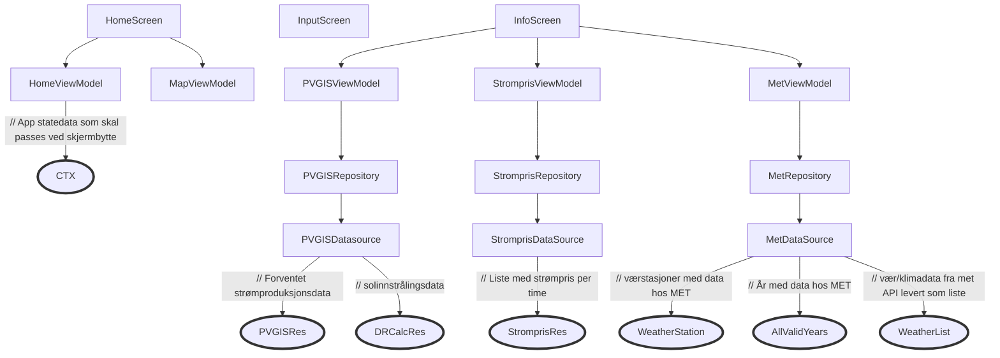
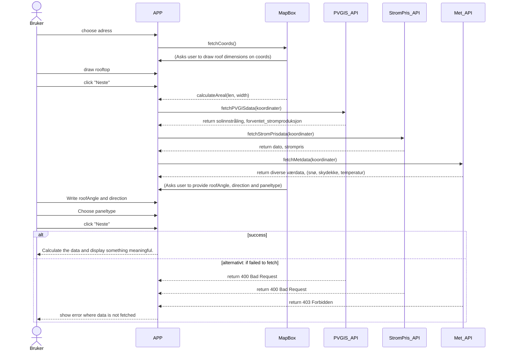

# MODELLERING

## Introduksjon
Denne filen er strukturet med denne korte introen, begrunnelse for valg av diagrammer, og til slutt selve diagrammene/beskrivelsene.

## Valg av diagrammer og begrunnelse
Vi har valgt disse diagrammene: 

- **Arkitekturskisse**: Gir en overordnet oversikt over de ulike APIene og hvordan data fra disse sendes til skjermene de skal til.

- **Sekvensdiagram**: For å beskrive samhandlingen mellom de ulike komponentene når bruker legger inn adresse, tegner takflate og velger panel.

---

## Arkitekturskisse

---

## Sekvensdiagram

