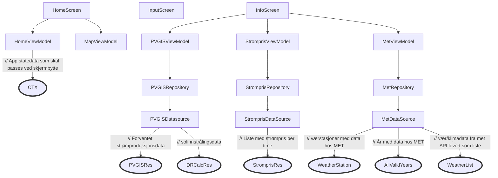
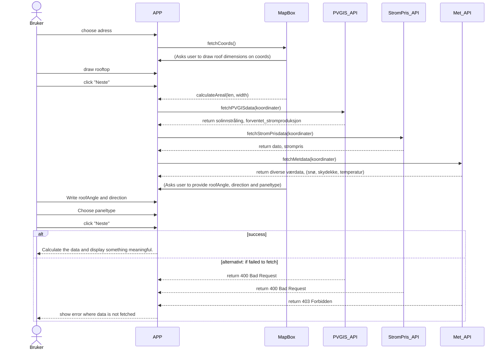
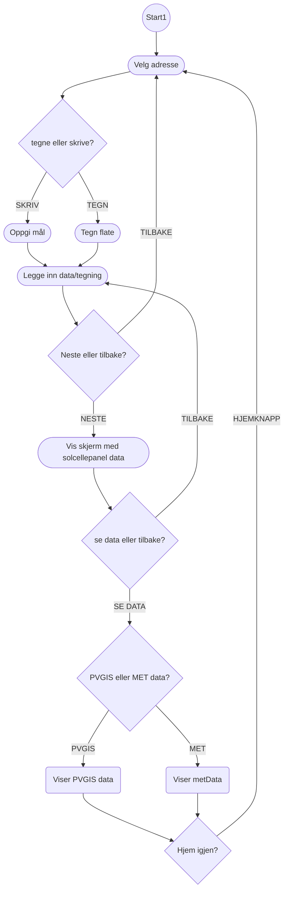

# MODELLERING

## Introduksjon
Denne filen er strukturet med denne korte introen, begrunnelse for valg av diagrammer, og til slutt selve diagrammene/beskrivelsene.

## Usecases
1. Som huseier ønsker jeg å sjekke det økonomiske solcellepotensialet til mitt eget tak, slik at jeg kan spare penger på strømregningen. (VIKTIGSTE USECASE)
2. Som solcellepanelselger ønsker jeg å søke opp solcellepotensialet til Oslo lufthavn, slik at jeg har konkrete data å bruke, når jeg skal pitche solcellepanel til Avinor.
3. Som nysgjerrig nabo ønsker jeg å lagre data om naboens solcellepotensial, slik at jeg kan argumentere for hvorfor det er lurt for dem å investere i solcellepanel.

## Valg av diagrammer og begrunnelse
Vi har valgt disse diagrammene: 

- **Arkitekturskisse**: Gir en overordnet oversikt over de ulike APIene og hvordan data fra disse sendes til skjermene de skal til.

- **Sekvensdiagram**: For å beskrive samhandlingen mellom de ulike komponentene når bruker legger inn adresse, tegner takflate og velger panel.

- **Aktivitetsdiagram**: Denne er ment til å vise hendelsesflyten i det viktigste usecasete. Med fokus fra navigasjon i kartet til visning av data på den endelige skjermen. Dette er hovedfunksjonaliteten i appen vår.

---

## Arkitekturskisse

---

## Sekvensdiagram

---

## Aktivitetsdiagram

