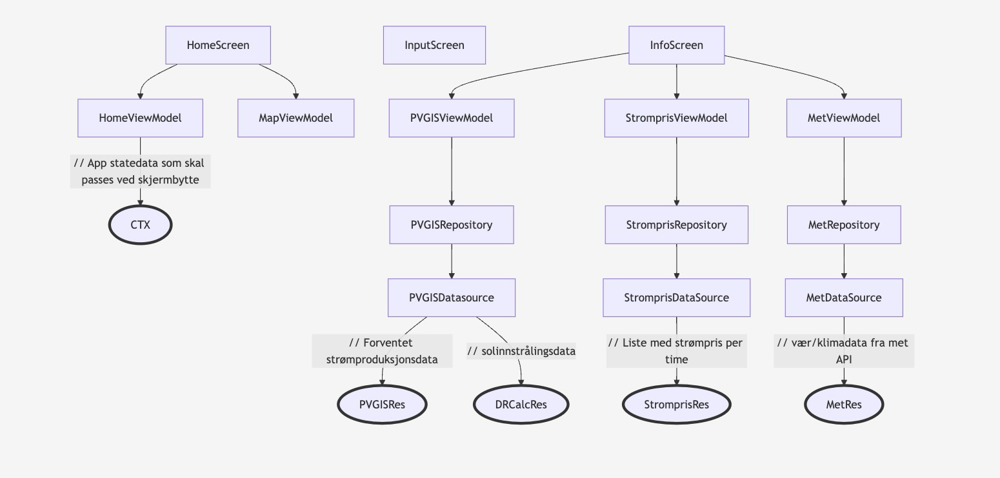

<p align="center">
  
</p>
<h1 align="center">WattsUpSun</h1>
<p align="center">En solcellepanel app fra prosjektarbeidet i IN2000 - Vår 2025</p>
<p align="center">
    <i>~ Laget av Kristin, Niklas, Jonatan, Danial, Affaq og Kavin ~</i>
</p>

WattsUpSun er en app designet for huseiere som ønsker å vurdere lønnsomheten av solcellepaneler. Appen lar huseier enkelt slå opp adresse, tegne takflate og legge inn areal/vinkel/retning for å beregne forventet strømproduksjon.

## Installasjon

For å laste ned og kjøre appen trenger du [git](https://git-scm.com) og [Android Studio](https://developer.android.com/studio). Når begge er installert, kan du klone prosjektet ved å kjøre følgende kommando i terminalen:

```
git clone https://github.uio.no/IN2000-V25/team-43.git
```

Deretter kan du åpne prosjektet i Android Studio, og kjøre appen i en emulator med API-level 34.

## Arkitektur

Dataflyten og filstrukturen vår er inspirert av [Model–view–viewmodel](https://en.wikipedia.org/wiki/Model%E2%80%93view%E2%80%93viewmodel) arkitekturen, noe som blant annet hjelper oss å holde UI og API logikk separat. Dette er viktig for å holde kodebasen enkel og oversiktig når prosjektet blir mer komplekst.



## Credits

- Takk til Fredrik Løvoll som hjalp oss med `reverseGeocode` koden.
