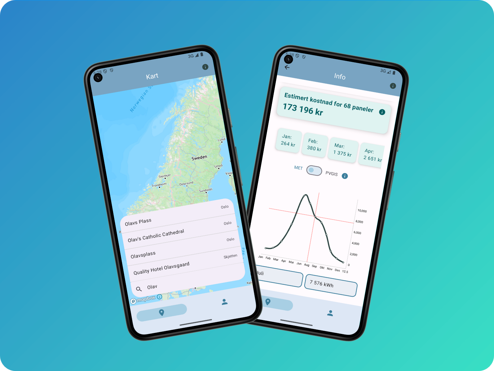

<p align="center">
  
</p>
<h1 align="center">WattsUpSun</h1>
<p align="center">En solcellepanel app fra prosjektarbeidet i IN2000 - Vår 2025</p>
<p align="center">
    <i>~ Laget av Kristin, Niklas, Jonatan, Danial, Affaq og Kavin ~</i>
</p>
<br />

WattsUpSun er en digital løsning utviklet for huseiere som ønsker å vurdere lønnsomheten av solcellepaneler.

Appen lar huseier enkelt slå opp egen adresse, markere takflate, legge inn tak- areal/vinkel/retning og type solcellepanel. Basert på disse nøkkelfaktorene beregnes et estimat på utgifter og innsparing av solcellepaneler, før huseier i det hele tatt har installert dem.

Dette gjør veien til investering i solenergi lettere, noe som kan bidra mer forutsigbar og bærekraftig inntekt på sikt.



## Installasjon

For å laste ned og kjøre appen trenger du [git](https://git-scm.com) og [Android Studio](https://developer.android.com/studio). Når begge er installert, kan du klone prosjektet ved å kjøre følgende kommando i terminalen:

```
git clone https://github.uio.no/IN2000-V25/team-43.git
```

Deretter kan du åpne prosjektet i Android Studio, og kjøre appen i en emulator med API-level 34.

## Datakilder

Korrekt og oppdatert data er essensielt for å få mest mulig nøyaktig beregning, derfor henter vi data fra flere pålitelige kilder:

- Værdata fra [Frost](https://frost.met.no).
- Strømpriser fra [HvaKosterStrømmen](https://www.hvakosterstrommen.no/strompris-api).
- Kart- og lokasjonsdata fra [Mapbox](https://mapbox.com).
- Solstrålingsdata fra [PVGIS](https://joint-research-centre.ec.europa.eu/photovoltaic-geographical-information-system-pvgis_en) for å sammenlikne med [Frost](https://frost.met.no).

## Tillatelser

For å få mest mulig ut av appen og all funksjoneliteten den tilbyr, må appen ha tilgang til visse systemfunksjoner som er står definert i `AndroidManifest.xml` filen:

- `INTERNET`: som nevnt tidligere henter appen data fra diverse datakilder, og trenger naturligvis internett-tilgang for å gjøre det.
- `CAMERA` og `READ_MEDIA_IMAGES`: lar bruker legge til et profilbilde, enten med kameraet eller fra galleriet.
- `READ_EXTERNAL_STORAGE` og `WRITE_EXTERNAL_STORAGE`: gjør at appen kan lagre informasjon lokalt på brukerens enhet, som gjøres blant annet med profil- og adressedata.

## Biblioteker

Slik moderne utvikling har blitt til er det stort fokus på biblioteker for å unngå “_reinventing the wheel_”. Vi har ikke gjort noe annerledes, og bruker blant annet biblioteker fra forelesningene og obligene: [Jetpack Compose](https://developer.android.com/compose), [Ktor](https://ktor.io), [Navigation Compose](https://developer.android.com/develop/ui/compose/navigation), [Material3](https://developer.android.com/develop/ui/compose/designsystems/material3), [Coil](https://coil-kt.github.io/coil), og en del mer niche biblioteker:

- [Mapbox](https://mapbox.com): kart, koordinater og søk/autocomplete av adresse.
- [Turf](https://docs.mapbox.com/android/java/guides/turf): for å kunne markere tak på kartet.
- [MPAndroidChart](https://github.com/PhilJay/MPAndroidChart): graf til visualisering av solstrålingsdata.
- [DataStore](https://developer.android.com/topic/libraries/architecture/datastore): persistent lagring av data lokalt på enheten.
- [JUnit](https://junit.org/junit5), [Mockk](https://mockk.io), [Mockito](https://site.mockito.org), [Turbine](https://github.com/cashapp/turbine) og [Robolectric](https://robolectric.org): testing og mocking av alt fra UI til API.

## Credits

- Takk til Fredrik Løvoll som hjalp oss med `reverseGeocode` koden.
- Design av README er inspirert av [Stripe Android SDK](https://github.com/stripe/stripe-android) og [Spacedrive](https://github.com/spacedriveapp/spacedrive).
